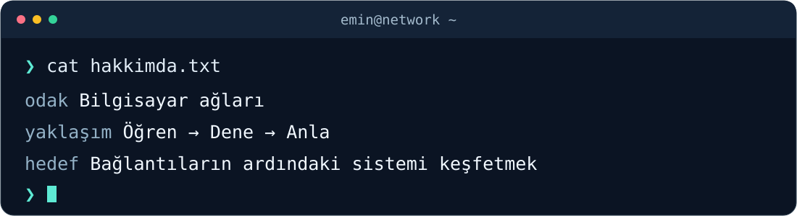

  

  
  
  
  

## 👋 Merhaba, ben Emin

İlgi alanım **bilgisayar ağları**. Bir paketin bir cihazdan diğerine giderken izlediği yol, ağların birbirini nasıl bulduğu ve bu iletişimin nasıl güvenli tutulduğu ilgimi çekiyor.

Bu profilde ağ teknolojileri üzerine öğrendiklerimi bir araya getirmeyi; notlar, küçük denemeler ve laboratuvar çalışmalarıyla ilerleyişimi paylaşmayı hedefliyorum.

  

## 🧭 Odaklandığım konular

| 🌐 Temeli anlamak | 🔀 Bağlantıyı kurmak | 🛡️ İletişimi korumak |
| :--- | :--- | :--- |
| **TCP/IP &amp; OSI** | **Routing &amp; Switching** | **Ağ güvenliği** |
| IP adresleme ve alt ağlar | Yönlendirme ve anahtarlama | Ağ bölgeleme |
| Paketlerin yolculuğu | VLAN, DNS ve DHCP | Erişim kontrolü |

## 🗂️ Ağ günlüğüm

**📝 Notlar** — Kavramları kendi cümlelerimle açıklamak. 
**🧪 Laboratuvarlar** — Topolojiler kurarak teoriyi denemek. 
**🔎 İncelemeler** — Bağlantıların nasıl çalıştığını adım adım anlamak.

Burası, bu çalışmalarla zaman içinde büyütmek istediğim kişisel öğrenme alanım.

---

  <b>Her bağlantı, keşfedilecek yeni bir yol.</b> 
  Bilgisayar ağları · Merak · Uygulama · Paylaşım

